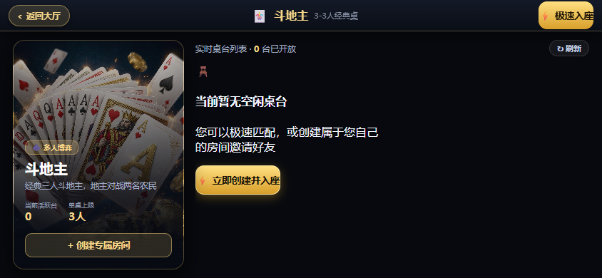
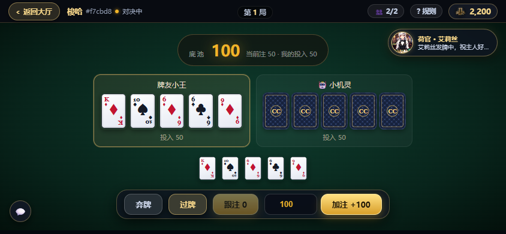
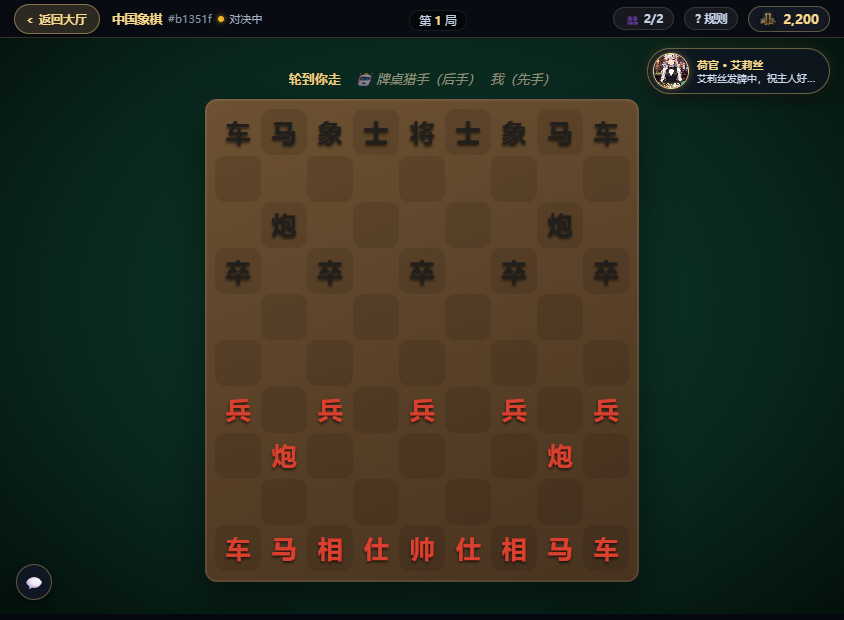
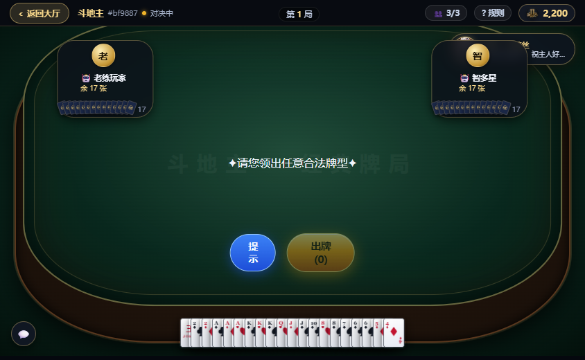
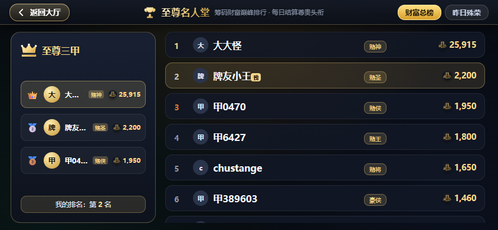
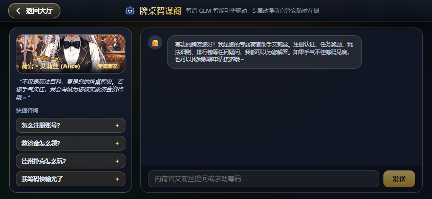
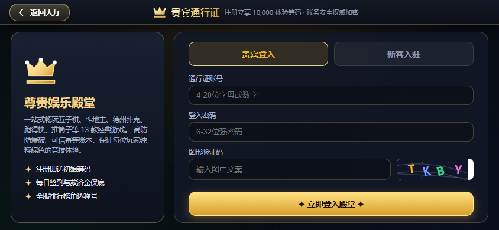
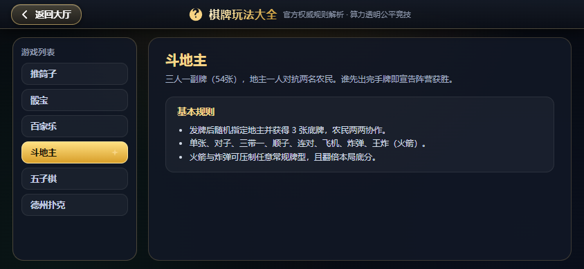

# Chess & Cards — 可插拔棋牌娱乐大厅

一套「大厅 + 可插拔游戏」的技术示范工程：**13 款**棋牌游戏共用一个大厅、一套账务、一个 WebSocket 房间容器。新增游戏只需实现 `GamePlugin` 接口并注册一行，大厅与房间服代码无需改动。

界面为**移动端横屏优先**设计（844×390 为基准），兼顾桌面浏览器。


> **本项目仅用于技术学习、架构研究与教学演示**，不提供、也不构成任何形式的赌博服务。详见文末[免责声明](#免责声明)。

## 目录

- [截图](#截图)
- [架构](#架构)
- [内置游戏](#内置游戏)
- [功能](#功能)
- [本地开发](#本地开发)
- [测试](#测试)
- [部署](#部署)
- [新增一个游戏](#新增一个游戏)
- [安全建议](#安全建议)
- [合规提示](#合规提示)

## 截图

全部截图为真机横屏视口（844×390）实拍，可点击查看原图。

<table>
  <tr>
    <td width="50%"><br /><sub><b>大厅</b>　左栏分类导航 + 游戏大卡 + 常驻荷官</sub></td>
    <td width="50%"><br /><sub><b>选台</b>　极速匹配或创建专属房间</sub></td>
  </tr>
  <tr>
    <td><br /><sub><b>21点</b>　押注区、发牌区、走势开奖三栏并排</sub></td>
    <td><br /><sub><b>梭哈</b>　底池、玩家牌面与操作条一屏容纳</sub></td>
  </tr>
  <tr>
    <td><br /><sub><b>中国象棋</b>　棋盘自适应高度，不裁切</sub></td>
    <td><br /><sub><b>骰宝</b>　押注格 + 实时奖池 + 走势</sub></td>
  </tr>
</table>

### 更多界面

| 推筒子 | 百家乐 | 斗地主 |
| --- | --- | --- |
|  |  |  |
| 天地人三门押注，荷官在侧 | 闲/庄/和三方盘口，补牌流程可视化 | 三人牌桌，手牌扇形排布 |

| 福利中心 | 排行榜 | 牌桌助手 |
| --- | --- | --- |
|  |  |  |
| 每日任务与救济金 | 至尊名人堂，称号每日结算 | 智谱 GLM 驱动的荷官管家 |

| 登录 | 规则 |
| --- | --- |
|  |  |
| 账号 + 密码 + 图形验证码 | 13 款游戏规则速查 |

## 架构

```
大厅前端 (React)  ──HTTP──▶  大厅 API (Fastify)  ──▶  PostgreSQL
      │                          │
      └─────WebSocket────────────┴──▶  游戏服容器 (ws)  ──▶  游戏插件
```

- **服务端权威**：客户端只发意图，合法性校验与结算全部在服务端。
- **进程隔离**：每个游戏独立插件，可独立发版、独立扩容。
- **元数据驱动**：游戏列表由游戏服上报，大厅动态渲染入口与分类。
- **账务可信**：只追加账本 + 唯一幂等键，杜绝重复入账。
- **可复现牌局**：洗牌由房间种子驱动，同一局可完整回放。

技术栈：TypeScript 5.7 / React 18 / Vite 6 / Fastify / ws / PostgreSQL（未配置时自动降级为内存仓储）。

## 内置游戏

| 分类 | 游戏 | 人数 | 说明 |
| --- | --- | --- | --- |
| 🎰 百人竞技 | 推筒子 | 1-5 | 押天地人三门，比庄家点数大即赢，赔率 1:1 |
| 🎰 百人竞技 | 骰宝 | 1-5 | 三颗骰子，押大/小/单/双/豹子/和值，赔率各不相同 |
| 🎰 百人竞技 | 百家乐 | 1-5 | 押闲、押庄或押和，标准补牌规则，庄赢抽水 5% |
| 🎰 百人竞技 | 21 点 | 1-5 | 两张起手，要牌至 21 点，超过即爆 |
| 🎰 百人竞技 | 斗牛 | 1-5 | 三张牌算牛点，押中牛几就赢几倍 |
| ♠️ 经典扑克 | 斗地主 | 3 | 54 张牌，座位最小者为地主并获底牌，地主 1v2 |
| ♠️ 经典扑克 | 跑得快 | 3 | 48 张牌各 16 张，支持顺子/连对/炸弹，先出完者胜 |
| ♠️ 经典扑克 | 德州扑克 | 2-6 | 两张底牌 + 五张公共牌，翻牌/转牌/河牌与摊牌 |
| ♠️ 经典扑克 | 梭哈 | 2-6 | 五张牌比牌型，含跟注/加注/弃牌，底池随局数增长 |
| ♠️ 经典扑克 | 翻金花 | 2-6 | 三张牌比大小，同花顺通杀 |
| ♟️ 智谋对弈 | 五子棋 | 2 | 15 路棋盘，标准五连判胜，先后手轮换 |
| ♟️ 智谋对弈 | 中国象棋 | 2 | 楚河汉界，炮马纵横，完整走子与将军判定 |
| ♟️ 智谋对弈 | 国际象棋 | 2 | 王将争锋，含王车易位、吃过路兵、升变 |

为聚焦玩法核心，部分规则做了简化（如斗地主省略叫地主环节、德州为单局独立结算），不代表完整商业规则。

## 功能

### 大厅与账号

- 未登录可直接浏览大厅与游戏列表，**点击进入房间时才要求登录**，降低首次体验门槛。
- 注册/登录使用「账号 + 密码 + 图形验证码」，密码以 scrypt 加盐散列存储。
- 防爆破：IP 维度 10 次 / 10 分钟，账号维度 5 次 / 10 分钟，超限自动锁定并提示剩余时间；验证码一次性消费，错误即失效。
- 顶栏实时显示余额、活动公告与音效开关，登录态下展示 VIP 身份。

### 移动端横屏 UI

界面按移动端横屏（844×390）为一等公民设计，而非桌面端缩放：

- **三栏信息布局**：押注区 / 发牌区 / 走势开奖并排，一屏内完成「下注 → 看牌 → 看走势」全流程，无需滚动。
- **操作区吸底**：`sticky` 固定在视口底部并叠加安全区，避免横屏时被浏览器工具栏遮挡。
- **棋盘等比自适应**：棋类棋盘按 `aspect-ratio` 与可用高度取较小值，不裁切、不拉伸。
- **刘海屏适配**：`viewport-fit=cover` + `env(safe-area-inset-*)`，横屏时处理左右两侧安全区。
- **触屏细节**：所有可点区域 ≥44px 命中尺寸，`:active` 按压反馈替代 hover，全局 `touch-action: manipulation` 消除双击缩放延迟。
- **可访问性**：`:focus-visible` 焦点环、`prefers-reduced-motion` 全量降级、数字使用 `tabular-nums` 对齐。

### 牌桌氛围

- **荷官系统**：牌桌右上角常驻荷官，按局面切换台词与立绘（待机 / 发牌 / 祝贺），三张立绘资源位于 `public/assets/dealer-*.jpg`。
- **牌桌动效**：`TableEffects` 统一处理筹码飞入、开奖揭晓、结算高亮等一次性编排动画，遵循「一局只出现一个视觉焦点」。
- **木质台面**：牌桌使用径向聚光压暗周边，视线被收束到牌面与底池。

### 任务系统

任务分「每日任务」与「成长任务」两组，目前共 12 条：

| 分组 | 任务 | 条件 | 奖励 |
| --- | --- | --- | --- |
| 每日 | 每日签到 | 每天进入大厅 | +100 |
| 每日 | 勤学苦练 | 当日完成 3 局 | +200 |
| 每日 | 牌桌常客 | 当日完成 10 局 | +600 |
| 每日 | 旗开得胜 | 当日赢下 1 局 | +300 |
| 每日 | 三战三捷 | 当日赢下 3 局 | +900 |
| 每日 | 大杀四方 | 单局净赢 500 以上 | +600 |
| 每日 | 多面手 | 当日体验 3 款不同游戏 | +500 |
| 每日 | 慷慨解囊 | 给荷官打赏 1 次 | +200 |
| 每日 | 救济金 | 筹码不足 100 时领取 | +500 |
| 成长 | 初出茅庐 | 累计完成 30 局 | +2,000 |
| 成长 | 百战之身 | 累计完成 100 局 | +6,000 |
| 成长 | 常胜将军 | 累计赢下 20 局 | +5,000 |

任务进度由结算事件驱动，奖励通过账本幂等入账（`task:<任务>:<周期>`），不会重复发放。周期按北京时间自然日重置；多档位任务共享同一进度计数，但领取标记各自独立。

### 排行榜与称号

按筹码余额降序排列，前 10 名依次获得：赌神、赌圣、赌侠、牌王、牌霸、千王、雀神、不败传说、幸运之星、天选之人。

### 机器人陪玩

房主在等待界面点击「+ 添加机器人陪玩」即可让 AI 入座，机器人入座即准备，人满自动开局。

决策链路：

```
回合到达 → 大模型（智谱 GLM）→ 合法性校验 → 失败则回退插件规则 AI
```

- 规则 AI 由各游戏插件实现（`botIntent`），保证机器人**永远不会卡住对局**
- 大模型只输出建议动作，真正的合法性由房间统一校验，非法动作会被丢弃后自动回退
- 未配置 `ZHIPU_API_KEY` 时纯用规则 AI，功能不受影响

接入智谱：在 `.env` 填入

```bash
ZHIPU_API_KEY=你的APIKey
ZHIPU_MODEL=glm-4-flash
```

`glm-4-flash` 为免费模型。模型输出采用「只返回 JSON」的约束，例如五子棋返回 `{"x":7,"y":7}`、斗地主返回 `{"cards":["S10","H10"]}`、德州返回 `{"action":"call"}`。

### AI 问答助手

大厅常驻「牌桌助手」，基于智谱 GLM 实现，承担两件事：

- **答疑**：注册登录、任务中心、排行榜称号、各游戏规则、机器人陪玩、断线重连等常见问题
- **救济**：玩家筹码见底时可以申请接济，助手酌情发放 200 筹码

发放逻辑的关键在于**模型无权决定资金**：

```
模型给"意向标记" → 服务端校验：是否真的在求助 → 余额是否低于 500 → 今日是否已领
                                                    ↓ 任一不满足则不发放并给出提示
```

- 单次额度 200、门槛 500、每人每天 1 次，全部写死在服务端
- 每次对话会把玩家余额作为系统信息告知模型，避免它胡乱承诺
- 奖励走账本幂等键 `assistant:<用户>:<日期>`，重复点击不会多发
- 触发标记但条件不满足时，服务端会追加一句准确的说明，不会被模型带偏
- 未配置 `ZHIPU_API_KEY` 时降级为关键词匹配的固定答复，功能不至于完全不可用
- 每用户每分钟最多 20 次，防止刷接口

### 视觉素材

界面配图（牌桌 hero、游戏卡片、荷官立绘、筹码图标）由 AI 生成，统一为「深色牌桌 + 金色光源」风格，存放于 `apps/lobby-web/public/assets/`。

**牌面为程序化生成的矢量图**，由 `scripts/gen-cards.mjs` 一次性产出 74 个 SVG（54 张扑克含大小王、9 张筒子牌、6 面骰子、1 张牌背），总计约 100 KB：

```bash
node scripts/gen-cards.mjs
```

- 文件按服务端牌 id 命名（`S14.svg` 即黑桃 A），前端直接拼路径引用
- 牌面比例 96×134（约 0.716），与标准扑克一致，任意尺寸不失真
- 高 DPI 屏幕下依然锐利，无需多倍图

素材与音效均为程序内自有资源，不引用任何第三方图片、字体或音频库，无版权与授权风险。

### 音效与背景音乐

**背景音乐**为两首 CC0 1.0（公有领域）循环曲，随仓库分发，位于 `apps/lobby-web/public/assets/music/`：

| 文件 | 曲目 | 作者 | 来源 | 许可 |
|---|---|---|---|---|
| `menu-theme.mp3` | Feel good slow ambient track with a beat | annandistance | OpenGameArt | CC0 1.0 |
| `upbeat-theme.mp3` | Rhythm Factory | Zane Little Music | OpenGameArt | CC0 1.0 |

CC0 允许无条件商用与再分发，此处仍标注出处以示尊重。顶栏 ⏭ 按钮可切换曲目。

若音乐文件加载失败，会自动回退到 Web Audio 实时合成的和弦循环，功能不中断。

**交互音效**全部由 Web Audio 实时合成，无音频文件：点击、发牌、出牌、过牌、押注、金币、胜利、失败。顶栏可分别开关音乐与音效，偏好写入 localStorage；受浏览器自动播放策略限制，首次点击页面后才开始播放。

## 目录

```
packages/protocol    前后端共享协议与类型（唯一来源）
packages/game-sdk    GamePlugin 契约、牌型引擎与牌力评估
packages/auth        JWT 签发与校验
apps/api-server      大厅业务 API（认证 / 任务 / 排行榜 / 钱包 / 账本）
apps/lobby-web       大厅前端（默认部署在 /lobby/ 子路径）
services/room-server WebSocket 游戏服容器（房间生命周期 / 断线重连 / 结算上报）
services/games/*     13 个游戏插件（每款一个独立包）
infra                部署脚本、systemd 单元、nginx 片段
scripts              e2e 冒烟测试、牌面生成与运维小工具
docs/screenshots     README 截图
```

## 本地开发

```bash
pnpm install
pnpm dev:api     # http://localhost:8080
pnpm dev:room    # ws://localhost:9000
pnpm dev:web     # http://localhost:5173/lobby/
```

未配置 `DATABASE_URL` 时使用内存仓储，无需数据库即可跑通全流程；配置后自动切换 PostgreSQL。

## 测试

```bash
# 游戏规则冒烟（直接驱动插件，不依赖网络）
pnpm --filter @cc/room-server exec tsx scripts/game-smoke.ts

# 端到端（需先启动 api 与 room）
pnpm e2e

# 指向任意已部署环境
API_BASE=https://example.com/lobby \
WS_BASE=wss://example.com/lobby/ws \
pnpm e2e

# 全游戏遍历：逐款注册、建房、添加机器人并验证开局（需先启动 api 与 room）
tsx scripts/play-all-games.ts
```

脚本默认连接 `127.0.0.1:8080` 与 `ws://127.0.0.1:9000/ws`，可在文件顶部修改。

## 部署

目标环境：Ubuntu 20.04+ / Node 20+ / PostgreSQL 14+ / nginx。

### 首次初始化（只需一次）

```bash
bash infra/setup-server.sh <数据库密码>   # swap / pnpm / PostgreSQL / 应用目录
cp infra/.env.example .env               # 填写随机密钥与 DATABASE_URL
bash infra/deploy.sh
```

### 日常更新

```bash
git archive --format=tar.gz -o deploy.tar.gz HEAD
# 上传并解压到目标目录后：
bash infra/deploy.sh
```

`deploy.sh` 会依次完成：安装依赖 → 构建前端 → 重启 systemd 服务 → 刷新 nginx 片段，全程幂等。

### 与同机其他站点共存

若目标机器的 80 端口已被其他站点占用，无需抢占端口。`infra/nginx-lobby.conf` 是一段可 `include` 到任意 `server` 块中的片段：

| 路径 | 去向 |
| --- | --- |
| `/lobby/` | 前端静态资源 (`apps/lobby-web/dist`) |
| `/lobby/api/` | 大厅 API `127.0.0.1:8080` |
| `/lobby/ws` | 游戏服 WebSocket `127.0.0.1:9000` |

`deploy.sh` 会自动备份被修改的站点配置为 `.bak.<时间戳>`。若需独立域名或独立端口，把该片段拆成完整 `server` 块即可。

### 服务管理

```bash
sudo systemctl status cc-api cc-room
sudo journalctl -u cc-room -f
```

## 新增一个游戏

1. 复制 `services/games/gomoku` 为新目录；
2. 实现 `GamePlugin`（至少 `meta` / `commands` / `onIntent` / `getSnapshot`）；
3. 在 `services/room-server/src/plugins.ts` 注册一行，并在 `room-server/package.json` 添加依赖；
4. 前端在 `apps/lobby-web/src/games/` 增加渲染组件，并在 `Room.tsx` 中分发；
5. 重新构建部署。

容器会校验插件 `apiVersion`，不兼容时拒绝加载，避免协议漂移。牌型相关的通用逻辑（解析、比较、牌力评估）放在 `packages/game-sdk/src/cards.ts`，新游戏可直接复用。

## 安全建议

- `.env` 已被 `.gitignore` 排除，**不要**把真实密钥、数据库密码、服务器地址提交进仓库或写进文档。
- `JWT_SECRET`、`INTERNAL_KEY` 必须使用随机值，禁止复用 `.env.example` 中的占位符。
- 建议服务器仅允许 SSH 密钥登录，关闭密码登录；数据库账号限制来源为本地回环。
- 对外暴露前配置 HTTPS，WebSocket 随之走 `wss://`。
- 定期轮换密钥；发现泄漏立即更换并强制所有会话重新登录。

## 合规提示

本平台面向**无赌注的休闲竞技**。以下红线属于硬性要求，不是可选项：

- 禁止任何形成资金闭环的设计：虚拟币提现、玩家间转让、平台抽水变现、兑换实物或等价物。
- 虚拟筹码仅用于记分，无任何货币价值，不可购买、不可兑换。
- 正式对外运营需依法办理游戏出版物号（版号）、ICP 备案、实名认证与防沉迷系统。
- 未成年人保护、内容审核、数据合规等义务由运营方自行承担。

---

## 免责声明

1. 本项目为**开源技术示范工程**，仅用于学习、研究与技术交流，作者未将其作为商业产品运营。
2. 本项目**不包含**任何充值、提现、兑换、抽水等资金功能，不具备、也不应被用于构建赌博服务。
3. 项目中的游戏名称与榜单称号仅为技术演示所用的通用词汇，不指向任何真实博彩活动。
4. 任何人将本项目用于商业运营或对外提供服务，须自行确保符合所在地法律法规（包括但不限于游戏版号、备案、支付与反洗钱要求），并独立承担全部法律责任。
5. 作者不对使用者基于本项目的部署、运营、修改及由此产生的任何直接或间接损失承担责任。
6. 如本项目内容无意中侵犯了您的权益，请联系作者删除。

## License

MIT
