# Chess & Cards — 可插拔棋牌娱乐大厅

一套「大厅 + 可插拔游戏」的全栈技术示范工程：**19 款**棋牌、麻将与休闲博弈游戏共用一个大厅、一套账务、一个 WebSocket 房间容器。新增游戏只需实现 `GamePlugin` 接口并放入 `services/games/`，容器自动扫描加载，大厅与房间服核心无需改动。

🌐 **在线体验地址**：[http://chess.fantasyclaw.top/lobby/](http://chess.fantasyclaw.top/lobby/)

界面以 **PC 1920×1080 横屏**为设计基准，采用九宫格游戏卡片与奢华黑金视觉风格，并向下自适应移动端横屏（844×390）。


> **本项目仅用于技术学习、架构研究与教学演示**，不提供、也不构成任何形式的赌博服务。详见文末[免责声明](#免责声明)。

## 目录

- [在线体验](#在线体验)
- [截图](#截图)
- [架构](#架构)
- [内置游戏](#内置游戏)
- [核心功能](#核心功能)
- [目录结构](#目录结构)
- [本地开发](#本地开发)
- [测试](#测试)
- [1Panel 一键部署与无感更新](#1panel-一键部署与无感更新)
- [传统服务器部署与 GM 客户端](#传统服务器部署与-gm-客户端)
- [新增一个游戏](#新增一个游戏)
- [安全建议](#安全建议)
- [合规提示](#合规提示)
- [优化方案书（单游戏热更新）](docs/优化方案书-单游戏热更新.md)

## 在线体验

- **游戏大厅**：[http://chess.fantasyclaw.top/lobby/](http://chess.fantasyclaw.top/lobby/)
- **进入即玩**：支持账号密码注册登录（含邀请码、安全邮箱、修改密码与邮箱找回密码）、**奇幻维度 OAuth 2.0 一键授权登录与绑定**，以及游客体验入口。

## 截图

全部截图均为 **1920×1080 横屏实拍**，可点击查看原图。

<table>
  <tr>
    <td width="50%"><br /><sub><b>大厅</b>　左栏分类导航 + 九宫格游戏卡 + 无缝公告跑马灯 + 互动荷官</sub></td>
    <td width="50%"><br /><sub><b>荷官衣柜</b>　Lv.1–Lv.26 好感度体系 + 34 款高清立绘皮肤 + 15 种个性声线</sub></td>
  </tr>
  <tr>
    <td>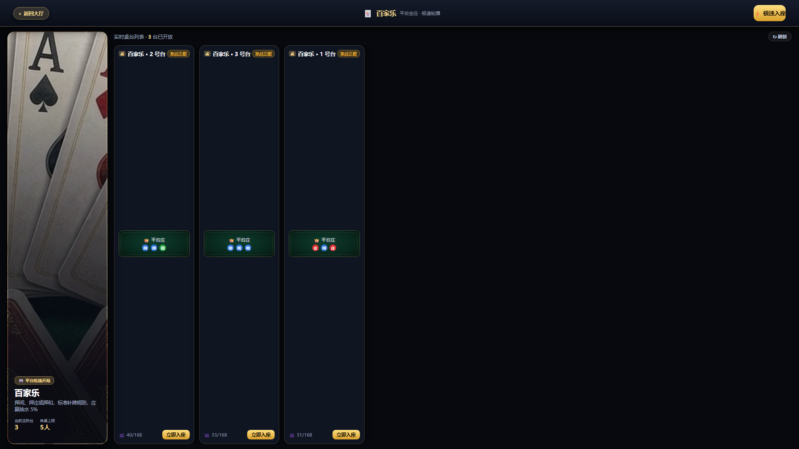<br /><sub><b>全屏选台</b>　百人竞技常驻台走势路单 / 机器人热战桌观战入座 / 极速匹配</sub></td>
    <td>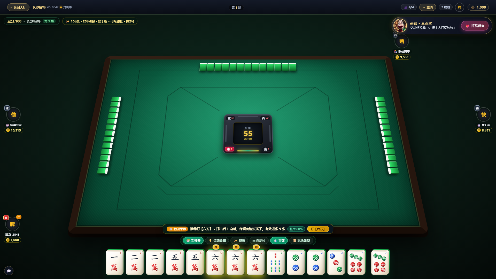<br /><sub><b>3D 雀神麻将</b>　立体牌桌、智能军师推荐、全 34 张牌真人神经网络语音播报</sub></td>
  </tr>
  <tr>
    <td>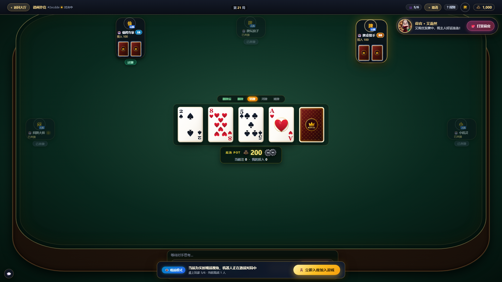<br /><sub><b>德州扑克</b>　奢华高清大牌面、底池筹码动效与观战一键入座</sub></td>
    <td>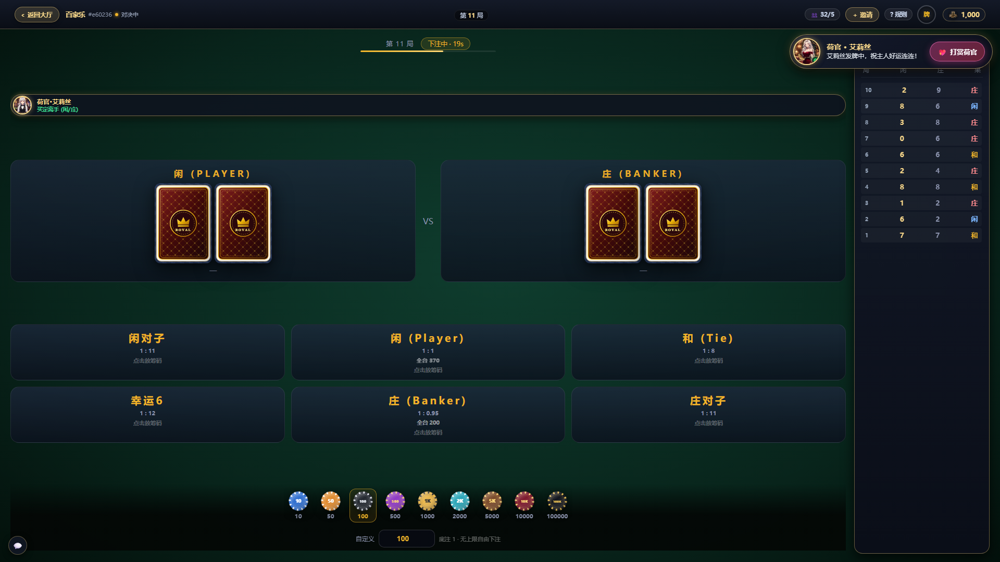<br /><sub><b>百家乐</b>　闲/庄/和三方盘口、顺序开牌播报与丝滑倒计时进度条</sub></td>
  </tr>
  <tr>
    <td>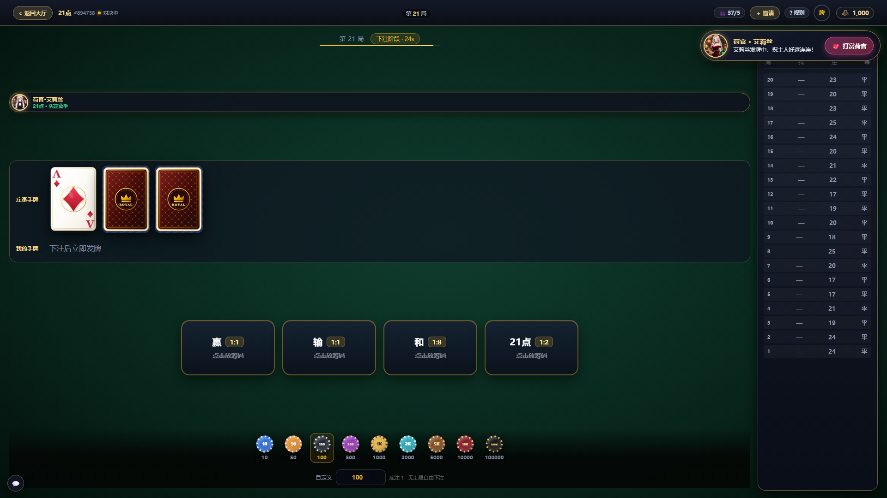<br /><sub><b>21点</b>　押注区、发牌区、走势开奖三栏并排与荷官逐段报点</sub></td>
    <td><br /><sub><b>骰宝</b>　高保真摇骰音效、逐颗开骰报点、实时奖池与走势</sub></td>
  </tr>
</table>

### 更多界面

| 推筒子 | 斗地主 | 梭哈 |
| --- | --- | --- |
| 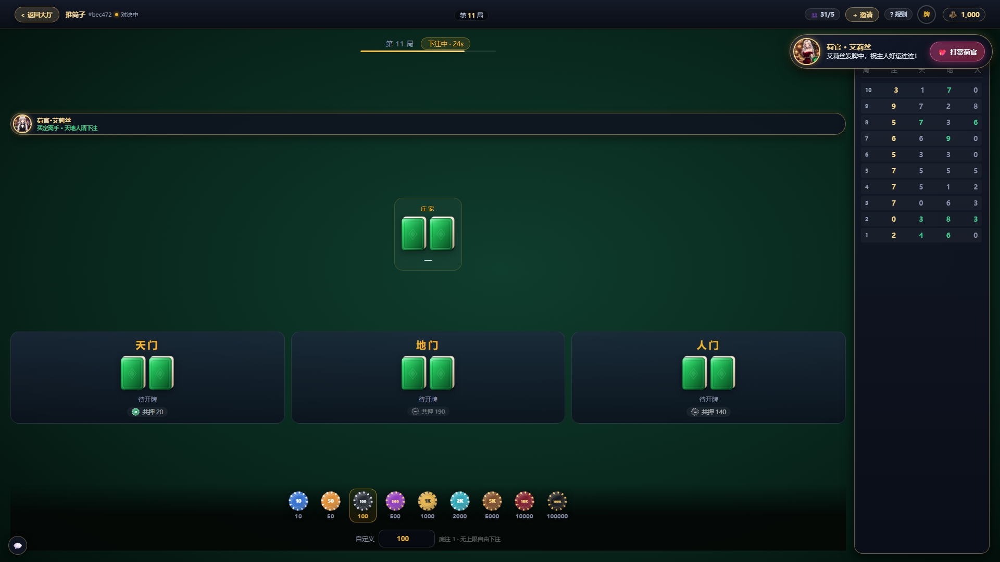 | 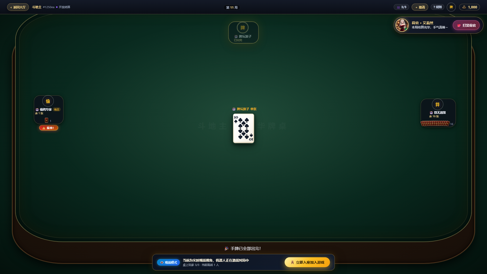 | 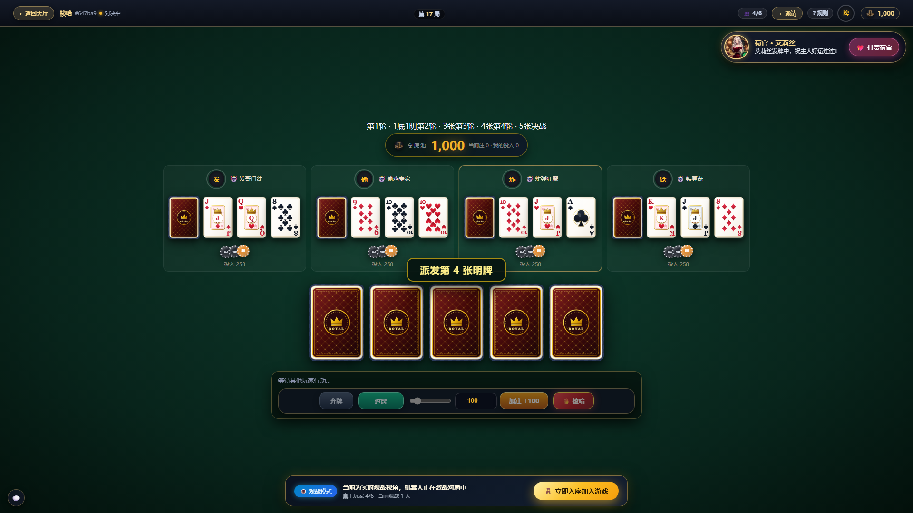 |
| 天地人三门押注，通杀/通赔语音播报 | 三人牌桌，奢华大牌面与连招特效 | 逐街发牌、底池与操作条一屏容纳 |

| 中国象棋 | 福利中心 | 排行榜 |
| --- | --- | --- |
| 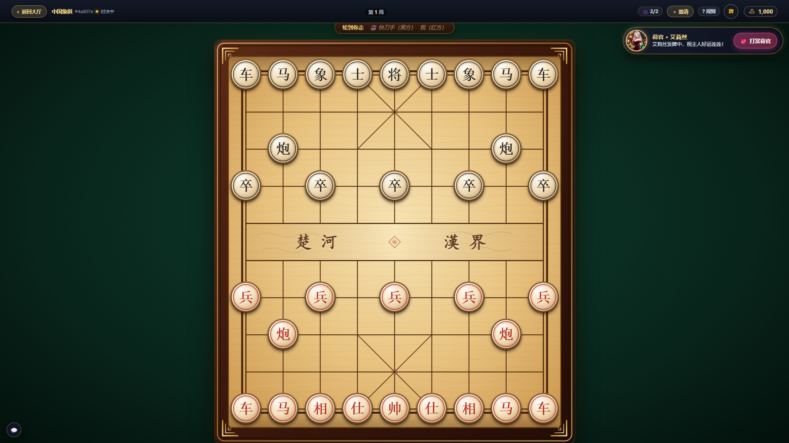 | 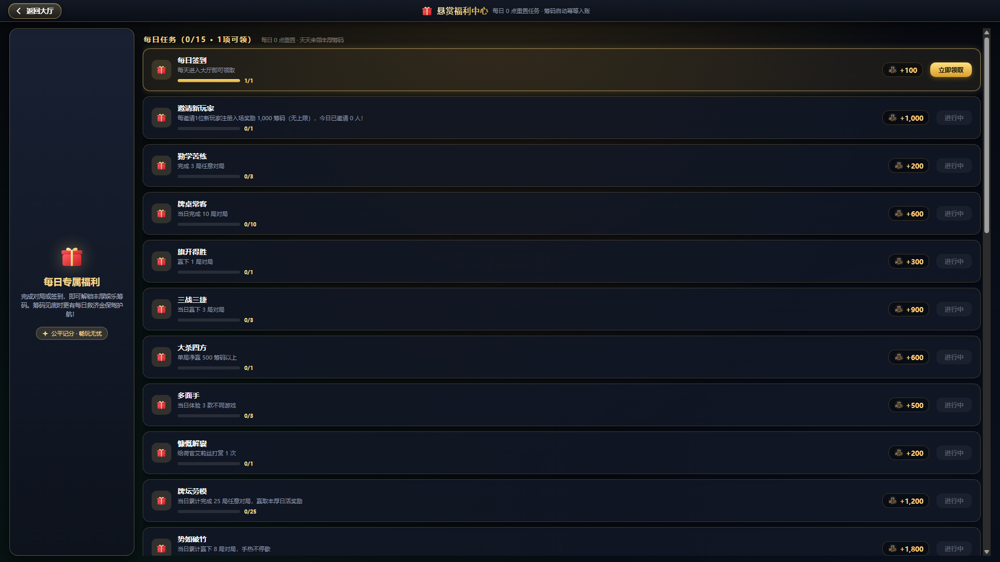 | 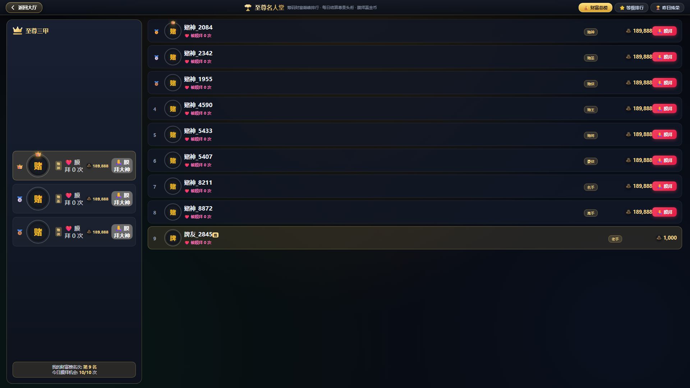 |
| 楚河汉界棋盘自适应高度，不裁切 | 每日任务、无限邀请奖励与救济金 | 至尊名人堂、全服膜拜与赌神播报 |

| 登录与 OAuth | 全游戏规则 |
| --- | --- |
| 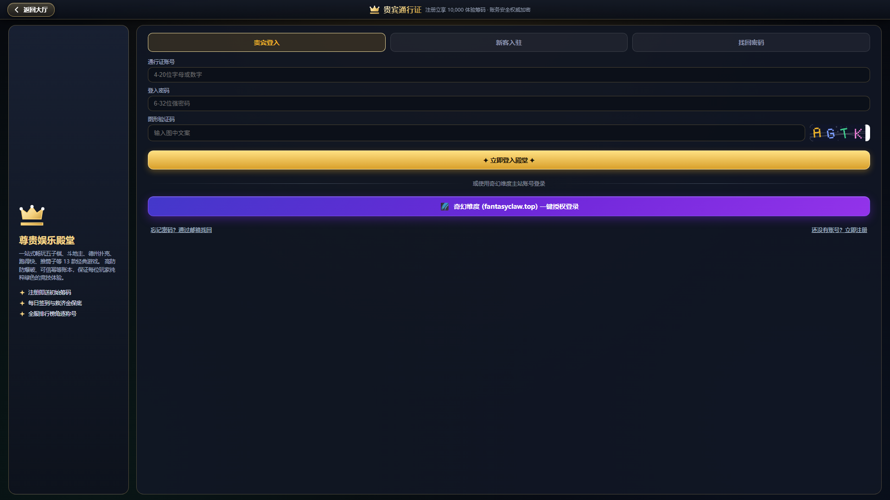 | 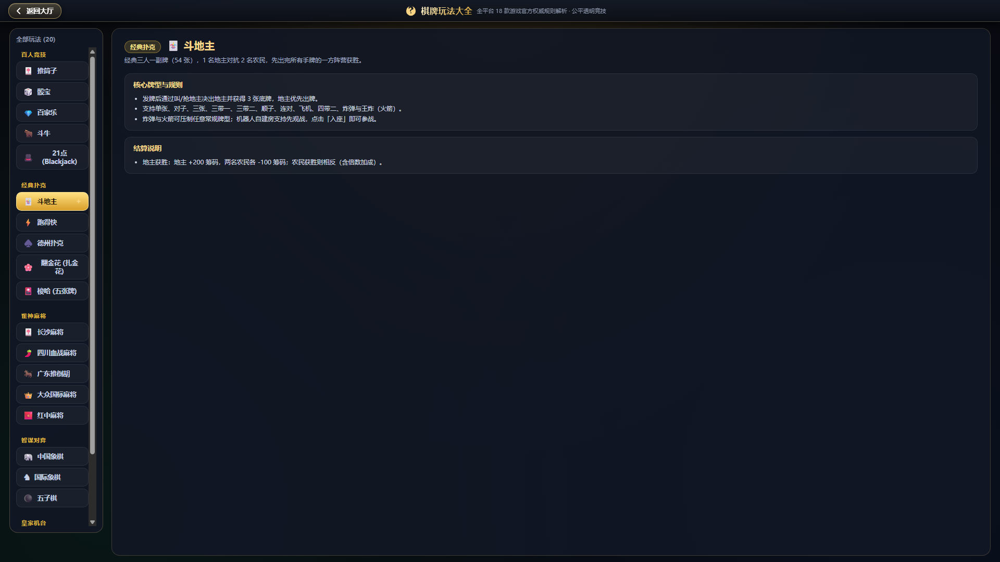 |
| 账号密码 + 图形验证码 + 奇幻维度 OAuth 一键登录 | 19 款游戏完整规则与赔率速查 |

## 架构

```text
大厅前端 (React 18 + Vite 6) ──HTTP──▶ 大厅 API (Fastify) ──▶ PostgreSQL 16
           │                                 │
           └──────────WebSocket──────────────┴──▶ 游戏服容器 (ws) ──▶ 19 个可插拔游戏玩法
```

- **服务端权威**：客户端只发意图，合法性校验、扣款、发牌、老虎机摇奖与结算全部在服务端完成。
- **插件自动发现**：`services/room-server` 动态扫描 `@cc/game-*` 插件包（支持单包多玩法变体），统一校验 `apiVersion`。
- **元数据驱动**：游戏列表、分类与桌台状态由游戏服实时上报，大厅动态渲染。
- **账务可信**：只追加账本（`ledger`）+ 唯一幂等键 + 本地结算 outbox 重投，杜绝重复入账与掉单。
- **可复现牌局**：洗牌由房间随机种子驱动，支持对局复盘记录查询。

技术栈：TypeScript 5.7 / React 18 / Vite 6 / Fastify 5 / ws / PostgreSQL 16（未配置时自动降级为内存仓储）/ Docker Compose / .NET 10 WPF（GM 运营中台）。

## 内置游戏

共内置 **19 款**游戏（大厅分类展示 18 款桌台玩法 + 顶栏独立疯狂老虎机）：

| 分类 | 游戏 | 人数 | 说明 |
| --- | --- | --- | --- |
| 🎰 百人竞技 | 推筒子 | 常驻百人（支持选台） | 押天地人三门比点数，分步播报天/地/人/庄及通杀通赔音效 |
| 🎰 百人竞技 | 骰宝 | 常驻百人（支持选台） | 三颗骰子高保真摇骰，押大/小/单/双/豹子/和值，逐颗报点 |
| 🎰 百人竞技 | 百家乐 | 常驻百人（支持选台） | 押闲、押庄或押和，标准补牌规则，先闲后庄分步开牌播报 |
| 🎰 百人竞技 | 21 点 | 常驻百人（支持选台） | 两张起手，要牌/双倍/庄家补牌，先报庄家再报玩家点数 |
| 🎰 百人竞技 | 斗牛 | 常驻百人（支持选台） | 五张算牛点，押中无牛/牛一至牛牛按对应倍数结算并语音播报 |
| ♠️ 经典扑克 | 斗地主 | 3（机器人热战桌） | 54 张奢华大牌面 1v2，支持炸弹/火箭/顺子/飞机音效与特效 |
| ♠️ 经典扑克 | 跑得快 | 3（机器人热战桌） | 48 张牌各 16 张，首出黑桃/红桃 3、能管必管 |
| ♠️ 经典扑克 | 德州扑克 | 2-6（机器人热战桌） | 两张底牌 + 五张公共牌，翻牌/转牌/河牌摊牌与赌场沉浸音效 |
| ♠️ 经典扑克 | 梭哈 | 2-6（机器人热战桌） | 逐街发牌比牌型，支持跟注/加注/弃牌/全压 |
| ♠️ 经典扑克 | 翻金花 | 2-6（机器人热战桌） | 三张牌闷抓/看牌比大小，同花顺通杀 |
| 🀄 雀神麻将 | 长沙麻将 | 4 | 108 张 258 硬将、起手胡、可吃碰杠、抓 2 鸟 + 智能出牌军师 |
| 🀄 雀神麻将 | 四川血战麻将 | 4 | 缺一门定缺、血战到底、刮风下雨即时杠分与查花猪/查大叫 |
| 🀄 雀神麻将 | 广东推倒胡 | 4 | 136 张带风箭牌、推倒胡买 4 马、明暗杠即时结算 |
| 🀄 雀神麻将 | 大众国标麻将 | 4 | 136 张标准竞技番型、可吃碰杠与多番叠加计算 |
| 🀄 雀神麻将 | 红中麻将 | 4 | 112 张带 4 张红中万能癞子、自摸胡/抢杠胡与扎 4 码 |
| ♟️ 智谋对弈 | 五子棋 | 2 | 15 路棋盘，标准五连判胜，先后手轮换 |
| ♟️ 智谋对弈 | 中国象棋 | 2 | 楚河汉界，完整走子、将军与绝杀判定 |
| ♟️ 智谋对弈 | 国际象棋 | 2 | 64 格西洋棋，含王车易位、吃过路兵、升变 |
| 🍒 独立娱乐 | 疯狂老虎机 | 单人独立入口 | 顶栏「信箱」旁专属入口，服务端权威 25 线摇奖、转轴动效与金币瀑布雨特效 |

> 为聚焦玩法核心，部分棋牌规则做了精简适配，不代表完整商业规则。

## 核心功能

### 1. 账号体系、OAuth 2.0、等级经验与安全找回

- **多方式登录与安全防护**：支持账号密码注册登录（scrypt 加盐散列 + 一次性图形验证码 + IP/账号双维度防爆破）、**奇幻维度 OAuth 2.0 一键登录与绑定**；个人中心支持**修改登录密码**、**绑定/修改安全邮箱**，登录页支持**通过安全邮箱验证码找回重置密码**。
- **账号等级与流水经验（Lv.1 – Lv.100）**：
  - 初始 Lv.1，满级 **Lv.100**；升级经验从 **100** 起步每级翻 2 倍，前后端使用 `BigInt` 与 PostgreSQL `numeric(40,0)` 存储，100 级零溢出；
  - **经验与有效流水 1:1 挂钩**，对局结算自动累积并连续升级；
  - **升级筹码递增领取**：升至 Lv.2 领 **1,000**、Lv.3 领 **2,000**……依次递增至 Lv.100 领 **99,000**，大厅顶栏实时展示等级与经验条，个人中心一键领取。

### 2. 荷官艾莉丝养成（Lv.1–26）、34 款高清皮肤与多数量打赏

- **好感度系统（Lv.1 – Lv.26） & 多数量批量打赏**：
  - 支持在大厅与牌桌内向荷官打赏 7 档礼物（送鲜花 10 ~ 嘉年华 5,000 筹码）；
  - **自由选择打赏数量**：内置 `×1 / ×5 / ×10 / ×52 / ×99` 快捷连击档位以及 `1 ~ 999` 自由步进/输入，实时显示总消耗与连击飞入特效，后端一次性原子扣款、累计等额好感度并按数量推进打赏任务。
- **34 款精美荷官皮肤**：
  - Lv.1 – Lv.16：涵盖经典礼服、旗袍、比基尼、兔女郎、女仆、赛博霓虹、纯白花嫁、深海人鱼、埃及艳后、赛车女郎、吸血鬼伯爵夫人、堕落炽天使、极乐花魁、银河星神、至尊金丝旗袍、神圣爱神；
  - **新增 Lv.17 – Lv.26（10 款绝美高定性感立绘）**：绯红丝绒、冰雪妖姬、暗夜黑天鹅、异域舞姬、九尾狐姬、鎏金神女、绯红女武神、璀璨珠后、黑玫女爵、倾世九天，换装后大厅与所有游戏牌桌实时同步。
- **Microsoft Neural TTS v2 真人级甜美语音 + 15 种个性声线**：
  - 预生成 **369 条**演播室级中文神经网络语音 MP3（含台湾甜心荷官台词、全部 34 张麻将出牌语音、5 款百人游戏下注与逐阶段开牌语音），告别机械合成音；
  - 内置 15 种自定义性格语音 + 后端 `/api/tts` 神经语音流自动兜底，支持衣柜试听、大厅互动与牌桌加油朗读。

### 3. 30 款尊贵头像框、赌神全服播报与无缝跑马灯

- **30 款筹码头像框**：涵盖基础款至 10 款至尊神级全息动效头像框（如混沌帝皇尊、太阳神·阿蒙拉、九五至尊·真龙天子、全知全能·宇宙奇点等），均使用游戏内虚拟筹码购买佩戴。
- **赌神上线全服公告 & 无缝跑马灯**：全服筹码前 10 名玩家登录时自动发布广播并触发金色号角音效；顶部公告栏采用双轨匀速（`34px/s`）丝滑滚动、悬停自动暂停，彻底消除跳帧与截断。
- **排行榜膜拜**：在排行榜点击玩家头像即可膜拜，每人每天 10 次机会，获得赞誉筹码回馈并实时累加展示目标玩家被膜拜次数。

### 4. 百人选台、经典扑克观战入座与 3D 麻将体验

- **百人竞技选台 & 丝滑节奏同步**：5 款百人竞技玩法（百家乐、21点、骰宝、斗牛、推筒子）均支持一键「极速开局」或进入「选台」查看多台实时人数与走势路单自由挑台；前端 100ms 丝滑倒计时进度条 + 2 秒服务端同步心跳，告别进度条停滞与流程卡顿。
- **经典扑克机器人自建房 & 观战/入座**：5 款经典扑克启动时自动开设 **3–7 间机器人热战桌**，进入默认观战，点击 **`🪑 立即入座加入游戏`** 即可无缝参战，也可随时切回观战。
- **5 款 3D 麻将 + 智能出牌军师**：配备 3D 立体绿背牌墙、胡碰杠吃动效、智能听牌进张推荐以及全 34 张麻将牌真人级语音出牌播报。
- **精美居中结算弹窗**：统一升级皇家黑金居中结算弹窗，支持一键「再来一局」，点击右上角 `✕` 立即返回大厅。

### 5. 零 502 无感更新与全服补偿机制

- **优雅排空（Drain Mode）**：触发平台更新时，游戏服自动进入排空模式——正在进行中的对局可完整打完，同时暂停开启新牌局；待所有活跃对局自然结束后自动完成滚动更新。
- **告别 502 错误页**：Nginx 502/503/504 与前端全局维护遮罩联动，展示友好的「平台正在紧急更新中，请耐心等待」状态页并自动重连。
- **自动 1,000 欢乐豆补偿**：更新完成后自动通过站内信箱向全体玩家幂等派发 **1,000 欢乐豆**更新补偿。

### 6. 音效、背景音乐与视觉素材

- **背景音乐**：支持自定义 MP3 替换（`apps/lobby-web/public/assets/music/`），构建时自动注入内容哈希防缓存，换歌即刻生效；进入游戏牌桌后自动静音大厅背景音乐，专注对局音效。
- **高保真交互音效**：Web Audio 实时合成筹码撞击、洗牌发牌、拟真骰盅摇晃与开盖、麻将碰击、炸弹火箭、老虎机转轴与金币瀑布雨、赌神号角等。
- **程序化奢华牌面**：`scripts/gen-luxury-cards.mjs` 与 `scripts/gen-cards.mjs` 生成高精度奢华大牌面 SVG，高 DPI 永不失真。

## 目录结构

```text
packages/protocol           前后端共享协议、等级经验计算、30 款头像框与 34 款荷官皮肤元数据
packages/game-sdk           GamePlugin 契约、牌型引擎、本地分级博弈机器人算法
packages/auth               JWT 签发与校验
apps/api-server             大厅业务 API（认证 / OAuth / 等级 / 任务 / 排行榜 / 邮箱 / 钱包 / Neural TTS / 维护补偿 / GM）
apps/lobby-web              大厅前端（React 18 + Vite 6，默认部署在 /lobby/ 子路径）
services/room-server        WebSocket 游戏服容器（房间调度 / 观战入座 / 排空模式 / 机器人驱动 / 结算 outbox）
services/games/*            15 个插件包（含 5 款麻将变体，共计 19 款游戏）
tools/CcGmClient            .NET 10 WPF 原生 GM 运营中台桌面客户端
infra                       1Panel 优雅更新脚本、Nginx 配置、维护页 maintenance.html、systemd 单元
Dockerfile                  多阶段国内高速构建镜像（runtime + web）
docker-compose.1panel.yml   1Panel 原生容器编排文件
docs/1panel-deploy.md       1Panel 详细部署与自动更新文档
```

## 本地开发

```bash
pnpm install
pnpm dev:api     # http://localhost:8080
pnpm dev:room    # ws://localhost:9000
pnpm dev:web     # http://localhost:5173/lobby/
```

未配置 `DATABASE_URL` 时自动使用内存仓储，无需安装数据库即可跑通全流程；配置后自动切换 PostgreSQL 并自动建表升级。

## 测试

```bash
# 全库 TypeScript 类型检查
pnpm typecheck

# 生产前端打包验证
pnpm --filter @cc/lobby-web build

# 游戏规则冒烟（直接驱动插件）
pnpm --filter @cc/room-server exec tsx scripts/game-smoke.ts

# 端到端冒烟测试（指向本地或线上环境）
API_BASE=http://chess.fantasyclaw.top/lobby \
WS_BASE=ws://chess.fantasyclaw.top/lobby/ws \
pnpm e2e
```

## 1Panel 一键部署与无感更新

完整指南见 [docs/1panel-deploy.md](docs/1panel-deploy.md)。整套服务（前端 + API + 房间服 + PostgreSQL 16 + 内置反代与友好维护页）已封装为 Docker Compose，数据库仅在容器内网通信不暴露公网，对外只暴露本机 `127.0.0.1:8090`：

### 首次部署（2 步完成）

1. **在 1Panel「主机 -> 终端」执行 1 条命令**：
   ```bash
   curl -fsSL https://raw.githubusercontent.com/lss19981213/Chess-and-Cards/main/infra/1panel-update.sh | bash
   ```
   *(国内服务器直连 GitHub 慢时可在链接前加 `https://ghfast.top/`)*
   脚本会自动克隆代码、生成高强度随机 `.env` 密钥（含 GM 口令 `ADMIN_TOKEN`）、拉起 PostgreSQL 16 与前后端容器并完成健康检查。

2. **在 1Panel「网站 -> 创建网站 -> 反向代理」**：
   - 主域名填你的域名（如 `chess.fantasyclaw.top`）
   - 代理地址填 `http://127.0.0.1:8090`
   - 访问 `http://你的域名/lobby/` 即可使用。

### 日常无感更新

- **方式 A（1Panel 一键点“执行”）**：在 1Panel「计划任务 -> Shell 脚本」新建手动任务执行 `bash /opt/1panel/apps/chess-and-cards/infra/1panel-update.sh`，自动执行「通知维护 → 等待在局玩家打完 → 增量构建滚动重启 → 恢复服务并自动发放全服 1,000 欢乐豆补偿」，绝不覆盖 `.env` 与数据库数据。
- **方式 B（GitHub Actions 全自动推送部署）**：在仓库 Secrets 配置 `DEPLOY_HOST`、`DEPLOY_USER`、`DEPLOY_SSH_KEY` 后，每次推送至 `main` 分支自动 SSH 触发更新（[.github/workflows/deploy-1panel.yml](.github/workflows/deploy-1panel.yml)）。

## 传统服务器部署与 GM 客户端

- **传统 Ubuntu / systemd 部署**：参考 `infra/setup-server.sh`、`infra/.env.example` 与 `infra/deploy.sh`。
- **GM 运营中台桌面客户端**：双击根目录 `GM工具.bat` 或 `GM客户端.vbs`（对应源码 `tools/CcGmClient`），支持连接 `http://chess.fantasyclaw.top` + `ADMIN_TOKEN`，提供大盘总览、经济流水审计、玩家封禁/改密/加减筹码、批量建号、房间实时透视、跑马灯广播与全服/定向带附件邮件发送。

## 新增一个游戏

1. 复制 `services/games/gomoku` 为新目录并修改 `package.json`（包名以 `@cc/game-` 开头）；
2. 实现 `GamePlugin`（`meta` / `commands` / `onIntent` / `getSnapshot`，可选 `botIntent`）；
3. 将新包加入 `services/room-server/package.json` 依赖（`plugins.ts` 会自动发现注册）；
4. 前端在 `apps/lobby-web/src/games/` 增加渲染组件并在 `Room.tsx` 分发；
5. 运行 `pnpm typecheck` 与 `pnpm --filter @cc/lobby-web build` 验证后推送部署。

## 安全建议

- `.env` 已被 `.gitignore` 排除，**切勿**将真实密钥、数据库密码或私钥提交至仓库。
- 生产环境必须设置 `NODE_ENV=production`，`JWT_SECRET`、`INTERNAL_KEY`、`ADMIN_TOKEN` 须为 32 位以上随机字符串，否则服务会拒绝启动。
- PostgreSQL 与房间服 9000 端口均保持内网隔离，仅由 Nginx / 1Panel OpenResty 反向代理对外暴露。
- 正式线上环境建议在 1Panel 一键签发 HTTPS 证书，WebSocket 将自动升级为 `wss://`。

## 合规提示

本平台面向**无赌注的休闲竞技**，严守以下红线：

- 禁止任何形成资金闭环的设计：虚拟筹码充值、提现、玩家间转让、平台抽水变现或兑换实物。
- 虚拟筹码仅用于游戏内记分、排行榜与装扮互动，无任何货币价值。
- 正式对外运营需依法办理游戏出版物号（版号）、ICP 备案、实名认证与防沉迷系统。
- 未成年人保护、内容审核与数据合规义务由运营方独立承担。

---

## 免责声明

1. 本项目为**开源技术示范工程**，仅用于学习、研究与技术交流，作者未将其作为商业产品运营。
2. 本项目**不包含**任何充值、提现、兑换或抽水变现等资金功能（百家乐规则中的「庄赢抽水 5%」仅为虚拟记分规则，不产生任何真实收益），不具备、也不应被用于构建赌博服务。
3. 项目中的游戏名称与榜单称号仅为技术演示所用的通用词汇，不指向任何真实博彩活动。
4. 任何人将本项目用于商业运营或对外提供服务，须自行确保符合所在地法律法规（包括但不限于游戏版号、备案、支付与反洗钱要求），并独立承担全部法律责任。
5. 作者不对使用者基于本项目的部署、运营、修改及由此产生的任何直接或间接损失承担责任。
6. 如本项目内容无意中侵犯了您的权益，请联系作者删除。

## License

MIT
