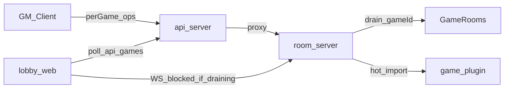

# Chess & Cards 优化方案书

**版本**：1.1  
**日期**：2026-11-19  
**核心选型**：方案 B — 单游戏热更新（排水 + 插件热加载）  
**状态**：P0–P2 已落地；P3 附录中观测字段 / 单游戏冒烟 / SCOPE 拆分已同步完成（Worker 隔离仍为远期）

---

## 1. 背景与目标

### 1.1 痛点

当前任意一款玩法出问题，运营只能走「整平台」更新链路：

1. `infra/1panel-update.sh` 对全站进入 `draining` → `updating`；
2. 重建包含全部 15 个游戏插件的 `runtime` 镜像并重启 `api-server` / `room-server`；
3. 玩家看到全站维护页，甚至触发全服 1,000 欢乐豆补偿。

结果是：**修一个游戏，拖累其它 18 款玩法与大厅体验**。

### 1.2 目标体验（方案 B）

| 场景 | 期望行为 |
| --- | --- |
| 单游戏规则 / 结算 bug | 仅对该 `gameId` 下架或排水；大厅、登录、任务、其它游戏照常 |
| 修复完成 | 热加载该插件（或仅重建受影响房间）；恢复入口 |
| 玩家感知 | **不出现**全站「平台紧急更新中」页；**不发放**全服更新补偿 |
| 平台级发版 | 仍走现有全量排水脚本（protocol / sdk / api / 共享契约变更时） |

### 1.3 非目标（本方案明确不做）

- 不做每游戏独立进程 / 独立容器的彻底微服务拆分（方案 C）。
- 不做前端微前端远程模块动态下发；UI 小改走「仅发 web」路径即可。
- 不替代现有全量 `1panel-update.sh`，而是与之并存。

---

## 2. 现状诊断

### 2.1 架构快照

```text
大厅前端 (React + Vite) ──HTTP──▶ API (Fastify) ──▶ PostgreSQL
         │                            │
         └──────────WebSocket─────────┴──▶ room-server（单进程加载全部 @cc/game-*）
```

| 层 | 路径 | 现状 |
| --- | --- | --- |
| 协议 | `packages/protocol` | `GameMeta` 无运营态字段 |
| SDK | `packages/game-sdk` | `GamePlugin` 契约清晰，`PLUGIN_API_VERSION` 可拦截不兼容插件 |
| 房间容器 | `services/room-server` | 启动时 `registerBuiltinGames` 一次扫描；全局 `MaintenanceMode` |
| 游戏插件 | `services/games/*` | 15 包、19 玩法，静态写入 `room-server` 依赖 |
| 部署 | `Dockerfile` + `docker-compose.1panel.yml` | `runtime` 镜像一次拷贝全部 `services/` |
| 更新脚本 | `infra/1panel-update.sh` | 全站 drain → 全量 build → 滚动重启 → 全服补偿 |

### 2.2 问题对照表

| 问题 | 证据 | 玩家影响 |
| --- | --- | --- |
| 维护粒度是整平台 | `services/room-server/src/registry.ts` 仅有全局 `normal \| draining \| updating`；`1panel-update.sh` 全站 drain | 修一个游戏也全站停新开局 / 出维护页 |
| 玩法与进程/镜像强绑定 | 15 个 `@cc/game-*` 写入 `services/room-server/package.json`；`Dockerfile` `runtime` 拷贝全部 `services/` | 任一插件改动都重建整镜像、重启整进程 |
| 插件只在启动时加载 | `services/room-server/src/plugins.ts` 无 unload / reload | 无法热换单个玩法 |
| `GameMeta` 无运营态 | `packages/protocol/src/types.ts` 无 `status` | 大厅无法按游戏展示「维护中」 |
| 前后端热更能力不对称 | 前端 `Room.tsx` 已 `lazy()`；后端无对等热更 | UI 小改可跟大厅发，规则 bug 仍逼整站更新 |

### 2.3 已具备、应复用的能力

方案实施时应**复用**而非重造：

- **插件契约**：`GamePlugin` + `PLUGIN_API_VERSION`（`packages/game-sdk`）。
- **账务可信**：只追加 `ledger` + 幂等键 + 结算 outbox。
- **前端按需加载**：玩法组件 `lazy()` + `Suspense`。
- **全局排水与维护页**：平台级发版继续使用；单游戏路径不得误调 `/maintenance/complete`。
- **审查修复成果**：2026-11-12 P0/P1 项已落地（密钥 fail-fast、验证码、结算 outbox 等），见 `docs/修复说明-2026-11-12.md`。

---

## 3. 总体优化地图

除核心「单游戏热更新」外，仓库仍有可排期优化项。优先级如下（**P0–P2 为热更新主线；附录为其它优化**）。

| 优先级 | 主题 | 说明 |
| --- | --- | --- |
| **P0** | 单游戏运营态 + 排水 | 协议、RoomManager、大厅展示、GM API；坏游戏可先「下架」而不停全站 |
| **P1** | 插件热加载 + 单游戏发布脚本 | 修规则后热更，无全局维护页 |
| **P2** | GM 面板 + 部署 SCOPE 拆分 + 按游戏冒烟 | 运营自助；web/api/room/full 分范围发布 |
| **P3** | 体验与工程债 | 首屏素材、回归测试、CI 增量、slots 双路径统一等（见第 8 节） |

---

## 4. 核心设计：单游戏热更新

### 4.1 目标架构



### 4.2 状态机

每个 `gameId` 独立运营态，与**全局** `MaintenanceMode` 并存：

| 状态 | 含义 | 大厅 | 房间行为 |
| --- | --- | --- | --- |
| `enabled` | 正常（缺省） | 可进入 | 正常开局 / 入座 |
| `disabled` | 运营下架 | 显示维护角标，不可进 | 拒绝 create / join / sit |
| `draining` | 单游戏排水 | 提示「即将维护」，不可新进 | 禁止新开局与新入座；**已在局可打完** |
| `updating` | 热加载中 | 同 disabled 展示 | 无活跃人类局后 unload → reload |

**约束**：

- 单游戏路径**不得**把全局模式设为 `updating`，也**不得**调用全服补偿接口。
- 全局维护仍用于 protocol / sdk / api / 跨游戏契约的真·平台发版。

### 4.3 协议扩展

在 `packages/protocol/src/types.ts` 的 `GameMeta` 增加（向后兼容，缺省 = `enabled`）：

```ts
/** 运营态：缺省 enabled，旧客户端忽略未知字段即可 */
status?: 'enabled' | 'disabled' | 'draining' | 'updating';
/** 大厅卡片 / 选台页展示文案，可空 */
statusMessage?: string;
```

透出路径：

- 房间服 `GET /games` → 带上各游戏 `status` / `statusMessage`；
- API `GET /api/games`（及房间服不可达时的兜底目录）同步字段；
- 大厅轮询 `/api/games` 驱动卡片态。

### 4.4 room-server 改造要点

#### 4.4.1 RoomManager（`services/room-server/src/registry.ts`）

- 新增 `Map<gameId, GameOpsState>`（status、message、since、可选 version）。
- `isDraining()` 保留全局语义；新增 `isGameUnavailable(gameId)` / `isGameDraining(gameId)`。
- `createRoom` / `joinOrCreate` / `sitDown` / 平台房新局：若该游戏非 `enabled` 则拒绝（明确错误码，便于前端提示）。
- `getGameMaintenanceStatus(gameId)`：返回该游戏活跃人类对局列表与数量，供脚本等待。

#### 4.4.2 热加载管线（`services/room-server/src/plugins.ts`）

| API | 行为 |
| --- | --- |
| `unloadGame(gameId)` | 确认无活跃人类局后：关闭空房、停止该游戏 bot 扩容、注销 factory / meta |
| `reloadGame(gameId \| pkgName)` | `import(specifier + '?t=' + Date.now())` 打破 ESM 缓存 → 校验 `PLUGIN_API_VERSION` → `register` → `ensurePlatformRooms` / `ensureBotHostedRooms` |

**同包多玩法（如 `@cc/game-cs-mahjong` 五变体）**：

- 按 **包** 热更时：连带 unload / reload 同包导出的全部 Plugin，避免半新旧混跑；
- 按 **gameId** 精确热更时：仅换该 factory，但文档与 GM 需提示「同源包建议整包更新」。

#### 4.4.3 HTTP 接口

房间服内部（`x-internal-key`）：

| 方法 | 路径 | 作用 |
| --- | --- | --- |
| `POST` | `/internal/games/:gameId/drain` | 进入排水 |
| `POST` | `/internal/games/:gameId/disable` | 立即下架（可选：强制踢观战、禁止新进） |
| `POST` | `/internal/games/:gameId/enable` | 恢复 |
| `POST` | `/internal/games/:gameId/reload` | unload + 热 import + register（body 可带 specifier / 版本标记） |
| `GET` | `/internal/games/:gameId/status` | 状态 + 活跃人类局数 |

API 对外 GM 镜像（`ADMIN_TOKEN` / Bearer）：

- `/api/admin/games/:gameId/drain|disable|enable|reload`
- `/api/admin/games/:gameId/status`
- `/api/admin/games`（列表含运营态，便于 GM 总览）

代理实现放在 `apps/api-server/src/routes/admin-internal.ts`（或独立 `admin-games.ts`），转发至 `ROOM_SERVER_URL`。

### 4.5 运行时文件布局（热更前提）

热加载需要进程能读到**更新后的插件文件**：

1. `docker-compose.1panel.yml` 为 `room-server` 增加卷，例如：

   ```yaml
   volumes:
     - ./data/outbox:/data/outbox
     - ./services/games:/app/services/games
   ```

2. 热更流程：宿主机 `git pull`（或仅同步变更包）→ 调用 `reload` → 进程内 `import` 新文件。
3. 开发态（`tsx watch`）可直接改源码后调 reload；生产态需保证容器内路径与 `discoverPluginPackages` 解析一致。

### 4.6 何时禁止单游戏热更（必须全量）

出现以下任一情况，**禁止**走 `1panel-game-update.sh`，必须走全量 `1panel-update.sh`：

| 变更范围 | 原因 |
| --- | --- |
| `@cc/protocol` 破坏性变更 | 前后端 / 多插件共享类型与消息 |
| `@cc/game-sdk` 的 `PLUGIN_API_VERSION` 升级或基类破坏性变更 | 热更后旧房间上下文不兼容 |
| `@cc/auth` / `api-server` 账务与结算契约 | 影响全部玩法结算 |
| 同时修改 ≥3 个无关游戏包 | 收益低于全量；降低漏更风险 |
| 数据库 schema 迁移 | 需 API 与迁移顺序保证 |

脚本侧应用简单检测（例如 `git diff` 路径白名单）：仅 `services/games/<pkg>/**`（及对应前端单文件，可选）才允许单游戏通道。

### 4.7 部署脚本

#### 新增：`infra/1panel-game-update.sh <gameId|pkgName>`

建议流程：

```text
1. git pull（与全量脚本相同的镜像源容错）
2. 校验变更范围：若触及 protocol/sdk/api → 拒绝并提示走全量
3. 同步/构建该游戏包到宿主机 ./services/games（卷已挂载则容器即时可见）
4. POST /api/admin/games/:id/drain
5. 轮询 status.activeHumanGames == 0（超时可配置，默认与全量类似）
6. POST /api/admin/games/:id/reload
7. POST /api/admin/games/:id/enable
8. 健康检查：/games 中该 gameId status=enabled 且 version/文案符合预期
```

**禁止**调用：

- `/api/admin/maintenance/drain|updating|complete`
- 全服补偿邮件逻辑

#### 保留并增强：`infra/1panel-update.sh`

- 继续承担平台级发版。
- 建议增加 `SCOPE=web|api|room|full`（P2）：
  - `web`：仅 `compose up -d --no-deps web`，**不**进全局 drain；
  - `api` / `room`：按需排水策略另定；
  - `full`：现有行为。

### 4.8 前端与 GM

#### 大厅（`apps/lobby-web`）

- `Lobby.tsx` / `GameRooms.tsx`：按 `status` 渲染维护角标与文案；`disabled` / `updating` / `draining` 禁止点击进房（或 draining 仅允许已在房玩家，大厅侧仍禁止新进）。
- `App.tsx`：进房前二次校验；WS 返回「游戏维护中」类错误时退回大厅并提示。
- 轮询间隔：与现有游戏列表刷新一致即可；GM 变更后可接受数秒延迟。

#### GM 客户端（`tools/CcGmClient`）

新增「游戏运维」页（P2）：

- 列表：gameId、名称、status、活跃人类局、版本；
- 操作：排水、禁用、启用、热重载；
- 危险操作二次确认；展示「同包连带」提示（麻将变体）。

### 4.9 前端 UI 热更边界

| 变更类型 | 推荐通道 | 是否全站维护页 |
| --- | --- | --- |
| 单游戏规则 / 机器人 / 结算插件 | `1panel-game-update.sh` | 否 |
| 单游戏或大厅纯 UI | `SCOPE=web` 只发 web 镜像 | 否（玩家刷新或下次进房拿新 chunk） |
| protocol / sdk / api / 多游戏 | `1panel-update.sh`（full） | 是 |

选项 B **不**引入微前端远程 `clientBundle` 动态加载；`GameMeta.clientBundle` 字段可保留为预留，本方案不依赖。

---

## 5. 分阶段实施清单

### 阶段 P0 — 单游戏上下架与排水（先止血）

**改动面**：

- `packages/protocol`：`GameMeta.status` / `statusMessage`
- `services/room-server`：`RoomManager` 按游戏状态；进房 / 开局拦截；status API
- `apps/api-server`：admin 代理 + `/api/games` 透出
- `apps/lobby-web`：卡片维护态与进房拦截

**验收**：

1. GM 禁用 `baccarat` 后，大厅该卡不可进，文案正确。
2. 其它游戏（含德州、麻将、老虎机入口）可正常匹配与结算。
3. 对 `baccarat` 排水：已在局玩家可打完；新玩家无法入座；活跃人类局归零后可 disable / enable。
4. **不**出现全站维护页，**不**发放更新补偿。

### 阶段 P1 — 热加载与单游戏发布脚本

**改动面**：

- `plugins.ts`：`unloadGame` / `reloadGame`（cache-bust import）
- `docker-compose.1panel.yml`：挂载 `./services/games`
- 新增 `infra/1panel-game-update.sh`
- 变更范围门禁（diff 白名单）

**验收**：

1. 仅修改 `services/games/dice` 规则后执行单游戏脚本：无全局 `updating`、无补偿邮件。
2. reload 后新开骰宝局行为符合新规则；旧局在 drain 阶段已自然结束。
3. 故意改动 `packages/protocol` 时脚本拒绝并提示走全量。
4. `cs-mahjong` 整包 reload 后五个变体均恢复 `enabled` 且可玩。

### 阶段 P2 — 运营体验与发布粒度

**改动面**：

- `CcGmClient` 游戏运维面板
- `1panel-update.sh` 支持 `SCOPE`
- `scripts/` 增加按 `gameId` 的冒烟（可基于现有 `game-smoke.ts` 扩展）

**验收**：

1. GM 桌面端可完成 drain →（等待）→ reload → enable，无需 SSH。
2. `SCOPE=web` 发布后在局玩家 WS 不断开；刷新后见到 UI 修复。
3. CI 或本地可对指定游戏跑冒烟。

### 阶段 P3 — 附录优化项

见第 8 节，按业务优先级穿插，不阻塞热更新主线。

---

## 6. 风险与缓解

| 风险 | 影响 | 缓解 |
| --- | --- | --- |
| Node ESM 模块缓存导致 reload 仍是旧码 | 热更失败、以为已修复 | `import(url + '?t=' + Date.now())`；验收时核对 `meta.version` 或构建戳 |
| `tsx` 与生产加载路径不一致 | 开发可热更、生产失败 | 统一经 `discoverPluginPackages` 的 file URL；compose 卷路径与镜像 `WORKDIR` 对齐并做一次生产演练 |
| 误走全局维护接口 | 全站维护页 + 误发补偿 | 单游戏脚本**硬编码禁止**调用 `/maintenance/*`；代码审查 checklist |
| 同包多玩法半新旧 | 麻将变体行为分裂 | 默认按包连带 reload；GM 文案提示 |
| 热更时仍有人类在局 | 状态错乱 | reload 前强制 `activeHumanGames === 0`；超时则保持 `draining` 并由人工处理 |
| 插件抛错导致房间进程异常 | 影响同进程其它游戏 | reload 包在 try/catch；失败则保持 disabled 并打日志；长期可评估 Worker 隔离（超出 B 范围） |
| 卷挂载覆盖镜像内文件权限/内容 | 部署漂移 | 文档明确「games 卷以宿主机 git 树为准」；全量构建仍更新镜像作为冷启动基线 |

---

## 7. 验收总表（Definition of Done）

| # | 场景 | 通过标准 |
| --- | --- | --- |
| 1 | 单游戏禁用 | 仅该游戏不可进；其余 18 款 + 大厅功能正常 |
| 2 | 单游戏排水 | 禁新开局；在局打完；无全站维护页 |
| 3 | 单游戏热更 | 改插件 → 脚本 → reload → 新局生效；无全服补偿 |
| 4 | 门禁 | 改 protocol/sdk 时单游戏脚本失败退出 |
| 5 | 平台全量 | 现有 `1panel-update.sh` 行为保持（drain → updating → 补偿） |
| 6 | 纯前端 | `SCOPE=web` 不触发房间排水（P2） |

---

## 8. 附录：其它优化建议（P3）

以下不阻塞单游戏热更新，建议单独建任务：

| 项 | 方向 | 备注 |
| --- | --- | --- |
| 首屏素材体积 | 大厅立绘 / 卡片图按需与尺寸适配；避免首屏全量 eager | 审查报告曾指出图片远大于 JS |
| 回归测试 | 按游戏插件的规则冒烟 + 关键结算用例进 CI | 已有 `game-smoke.ts` / `e2e-smoke.ts` 可扩展 |
| CI 增量 | 按变更路径只 typecheck/build 相关包 | 降低 PR 反馈时间 |
| slots 双路径 | 大厅 HTTP `POST /api/slots/spin` 与房间侧插件职责划清或合并 | 避免两套权威逻辑漂移 |
| 可观测性 | 按 `gameId` 的错误率、排水时长、reload 成败指标 | 便于运营判断是否升级为全量 |
| Worker 隔离（远期） | 单插件崩溃不影响同进程其它玩法 | 接近方案 C 的收益，成本高于 B；仅在热更稳定后评估 |

---

## 9. 参考路径速查

| 用途 | 路径 |
| --- | --- |
| 全局维护 | `services/room-server/src/registry.ts`、`apps/api-server/src/routes/maintenance.ts` |
| 插件发现 | `services/room-server/src/plugins.ts` |
| 游戏元数据 | `packages/protocol/src/types.ts` → `GameMeta` |
| 全量更新 | `infra/1panel-update.sh` |
| Compose | `docker-compose.1panel.yml` |
| 大厅进房分发 | `apps/lobby-web/src/components/Room.tsx` |
| GM API | `apps/api-server/src/routes/admin-internal.ts`、`tools/CcGmClient` |
| 历史审查 | `docs/代码审查报告-2026-11-12.md`、`docs/修复说明-2026-11-12.md` |

---

## 10. 修订记录

| 版本 | 日期 | 说明 |
| --- | --- | --- |
| 1.0 | 2026-11-19 | 初稿：诊断 + 方案 B 架构 + P0–P3 分期 + 风险与验收 |
| 1.1 | 2026-11-19 | 实施完成：协议 status、单游戏排水/热更、GM 面板、`1panel-game-update.sh`、`SCOPE`、按 GAME_ID 冒烟 |
